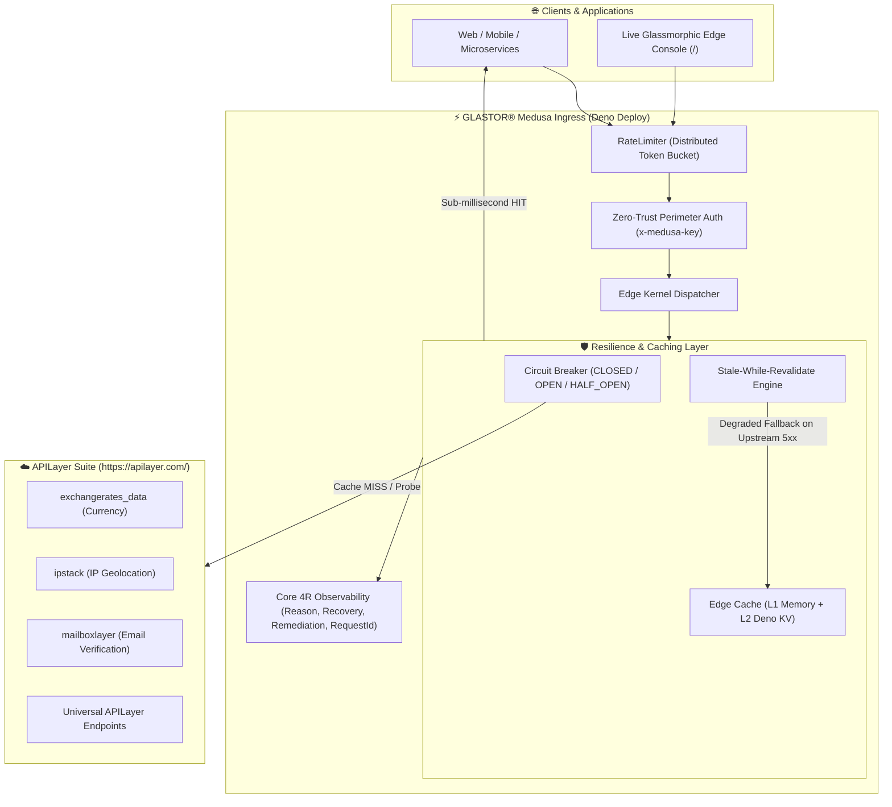

<div align="center">

# ⚡ GLASTOR® Medusa

**The high-performance, resilient Edge API Gateway & Caching Proxy for APILayer on Deno Deploy.**

[](LICENSE)
[](https://github.com/glastor-core/medusa/actions/workflows/ci.yml)
[](https://deno.com/)
[](https://deno.com/deploy)
[](https://github.com/glastor-core)
[](/openapi.json)

<p align="center">
  <a href="#-architecture">Architecture</a> •
  <a href="#-features">Features</a> •
  <a href="#-api-endpoints">Endpoints</a> •
  <a href="#-quick-start">Quick Start</a> •
  <a href="#-deno-deploy-setup">Deno Deploy</a> •
  <a href="#-license">License</a>
</p>

---

</div>

## 🏛️ Architecture



---

## 🌟 Key Features

- **🚀 Single-Flight Request Deduplication**: Prevents "Cache Stampede / Thundering Herd" problems
  by coalescing simultaneous concurrent requests for the same resource into a single outbound
  promise to APILayer (`x-glastor-single-flight: COALESCED`).
- **⏰ Proactive Deno.cron Pre-warming**: Native background serverless cron job that pre-refreshes
  key currency pairs every 10 minutes, guaranteeing sub-millisecond edge cache hits without cold
  start latencies.
- **⚡ Quota Preservation & Deno KV Caching**: Eliminates redundant calls and saves monthly APILayer
  tier limits by maintaining multi-tiered edge cache (L1 Memory + L2 Deno KV) with dynamic TTL.
- **🛡️ Stale-While-Revalidate Grace Fallback**: If APILayer experiences downtime or quota
  exhaustion, Medusa automatically serves cached stale responses (`x-glastor-cache: STALE`) without
  throwing outages to end users.
- **🔒 Autonomous Circuit Breaker**: Fast-fails downstream requests when upstream error thresholds
  are exceeded, preventing cascade timeouts and server lockups.
- **🌐 Distributed Rate Limiting**: Enforces sliding-window rate limiting per client IP or token
  using Deno KV atomic commits.
- **🔍 Core 4R Observability**: Every error implements the Glastor Standard: `code`, `reason`,
  `recovery`, `remediation`, and correlation `requestId`.
- **🧪 Live Glassmorphic Console**: Beautiful dark-mode dashboard at `/` for interactive edge
  testing, latency measurement, and health tracking.
- **🚀 Multi-Runtime / Zero-Config**: Native to Deno 2 and Deno Deploy with zero build step
  required.

---

## 📡 API Endpoints

| Method | Endpoint                 | Description                                                | Default Cache TTL |
| :----- | :----------------------- | :--------------------------------------------------------- | :---------------- |
| `GET`  | `/`                      | Live Edge Interactive Console & Dashboard (HTML or JSON)   | Real-time         |
| `GET`  | `/health`                | Gateway health status, circuit breakers, and telemetry     | Real-time         |
| `GET`  | `/openapi.json`          | OpenAPI 3.1 self-describing contract                       | Static            |
| `GET`  | `/v1/currency/convert`   | Currency conversion (`?from=USD&to=EUR&amount=100`)        | 10 minutes        |
| `GET`  | `/v1/currency/latest`    | Latest exchange rates (`?base=USD&symbols=EUR,GBP`)        | 15 minutes        |
| `GET`  | `/v1/ip-geo/lookup`      | IP Geolocation (`?ip=8.8.8.8` or auto-detect from client)  | 24 hours          |
| `GET`  | `/v1/email-verify/check` | Email deliverability & MX check (`?email=user@domain.com`) | 1 hour            |
| `ALL`  | `/v1/proxy/*`            | Universal resilient proxy to **any** APILayer endpoint     | Configurable      |

---

## 🚀 Quick Start

### Prerequisites

- [Deno](https://deno.com/) 2.x installed.
- APILayer API Key from [apilayer.com](https://apilayer.com/).

### Local Development

1. **Clone & Configure Environment**:
   ```bash
   cp .env.example .env
   # Edit .env and insert your APILAYER_API_KEY
   ```

2. **Run Dev Server with Watch Mode**:
   ```bash
   deno task dev
   ```

3. **Open Edge Console**: Visit [http://localhost:8000](http://localhost:8000) to access the live
   glassmorphic edge console.

4. **Run Quality Suite & Tests**:
   ```bash
   deno task check   # Type checking
   deno task lint    # Code linting
   deno task test    # Unit & integration tests
   deno task fmt     # Code formatting
   ```

---

## ☁️ Deno Deploy Setup

### Option 1: Automatic GitHub Integration (Recommended)

1. Push this repository to your GitHub organization (`glastor-core/medusa`).
2. Log in to [Deno Deploy Console](https://console.deno.com/) and create a **New Project**.
3. Link your GitHub repository and set the entrypoint to:
   ```
   src/server.ts
   ```
4. In Project **Settings > Environment Variables**, add:
   - `APILAYER_API_KEY`: `your_apilayer_access_key`
   - `MEDUSA_API_KEY`: `your_private_gateway_token` _(Required in production for perimeter
     authentication)_
   - `CORS_ALLOWED_ORIGINS`: _(Optional: comma-separated list of allowed origins, defaults to `*` in
     dev)_

### Option 2: Deploy via GitHub Actions

Use the included [deploy.yml](.github/workflows/deploy.yml) workflow:

- Configure GitHub repository secret `DENO_DEPLOY_TOKEN` (from
  [Deno Deploy Access Tokens](https://console.deno.com/account#access-tokens)).
- Every push to `main` automatically runs checks, tests, and deploys globally via
  `jsr:@deno/deployctl`.

---

## 📄 License

Licensed under the **Apache License 2.0**. See [LICENSE](LICENSE) for details.

---

<div align="center">
  <sub>Engineered by <a href="https://github.com/glastor-core">GLASTOR® Core</a> &middot; Built on Deno 2</sub>
</div>
